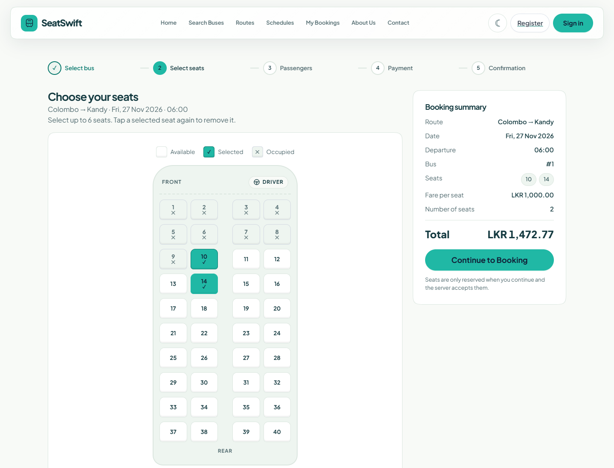
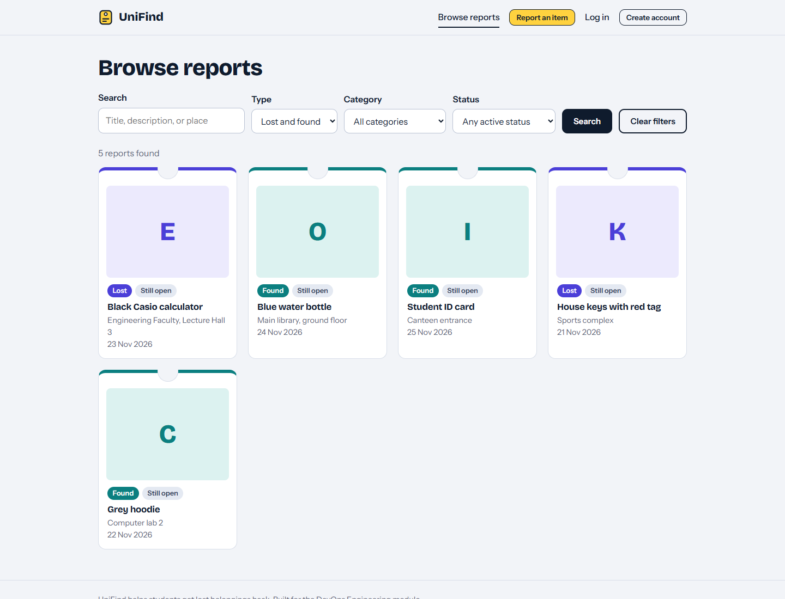
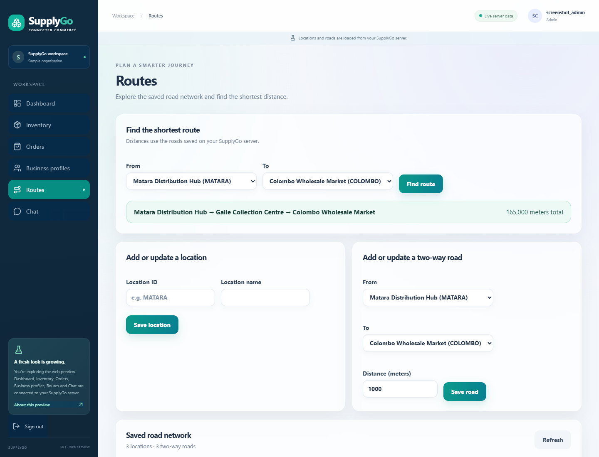

**Undergraduate Developer · Full-stack Development · Backend Systems**

---

## 🚀 Featured projects

<table>
<tr>
<td width="50%" valign="top">

<h3>🚌 <a href="https://github.com/uvinN20/SeatSwift">SeatSwift</a></h3>

Fullstack bus reservation platform with route search, schedules, seat selection, booking rules, and passenger, owner, and administrator workflows.

<code>Java 25</code> <code>Spring Boot</code> <code>React</code> <code>TypeScript</code> <code>MySQL</code>

<a href="https://github.com/uvinN20/SeatSwift">Source code &amp; documentation →</a>

</td>
<td width="50%" valign="top">

<h3>🔎 <a href="https://github.com/uvinN20/unifind">UniFind</a></h3>

Campus lost-and-found web app with searchable reports, item claims, recovery tracking, role-based access, containerization, and CI. <em>Team project.</em>

<strong>My contribution:</strong> Added the <a href="https://github.com/uvinN20/unifind/commit/1dbe0b5f4c65de84031d2020e6c67d41a0e55193">GitHub Actions CI workflow</a>.

<code>React</code> <code>Express</code> <code>MongoDB</code> <code>Docker</code>

<a href="https://github.com/uvinN20/unifind">Source code &amp; documentation →</a>

</td>
</tr>
</table>

<table>
<tr>
<td width="50%" valign="top">

<h3>📦 <a href="https://github.com/uvinN20/SupplyGo">SupplyGo</a></h3>

Java supply-chain and networking system covering TCP client-server communication, concurrency, authentication, inventory/order services, and integration tests. <em>Team project, in development.</em>

<strong>My contribution:</strong> Connected the <a href="https://github.com/uvinN20/SupplyGo/commit/c249dae82ad1d8b377e2c078045dbaed26ddbdc5">React route-planning page to the Java service</a>.

<code>Java 25</code> <code>TCP/IP</code> <code>JUnit</code> <code>Maven</code>

<a href="https://github.com/uvinN20/SupplyGo">Explore source →</a>

</td>
<td width="50%" valign="top">
<h3>🛍️ <a href="https://github.com/uvinN20/lavendra-boutique">Lavendra Boutique</a></h3>

Frontend e-commerce application with product discovery, search, filters, shopping cart, wishlist, and responsive views.

<code>Vue 3</code> <code>TypeScript</code> <code>Pinia</code> <code>Tailwind CSS</code>

<a href="https://github.com/uvinN20/lavendra-boutique">Explore source →</a>

</td>
</tr>
</table>

Screenshots captured from local runs with sample records.

## Hello, I'm Uvin

I'm an undergraduate developer from **Sri Lanka** who enjoys building software for real-world problems — from booking systems and campus tools to networked Java applications.

I work across **frontend and backend development**, with a growing focus on **API design, automation, system reliability, and DevOps**. I care about more than getting a screen to look right: authorization, validation, data integrity, tests, architecture, and documentation matter too.

- **Education:** Faculty of Engineering, University of Ruhuna
- 🧪 **Engineering interests:** Fullstack development, backend systems, automated testing, and CI/CD
- 🌱 **Learning next:** Next.js, cloud deployment, and applied AI/ML
- 🎯 **Goal:** Ship well-engineered projects and prepare for software engineering internships in 2027

## Technology by project

**[SeatSwift](https://github.com/uvinN20/SeatSwift)**

  

**[UniFind](https://github.com/uvinN20/unifind)**

    

**[SupplyGo](https://github.com/uvinN20/SupplyGo)**

  

**[Lavendra Boutique](https://github.com/uvinN20/lavendra-boutique)**

  

## 🧪 Engineering evidence

- **UniFind:** GitHub Actions runs API tests, builds the React frontend, and checks Docker container health. [Review CI runs](https://github.com/uvinN20/unifind/actions).
- **SeatSwift:** Repository contains Spring Boot service/security tests and Playwright browser test scenarios.
- **SupplyGo:** JUnit tests cover network communication, protocol behavior, inventory, authentication, and orders.

These are verifiable engineering artifacts, not claims that every project is already running in production.

## More backend work

- [FastAPI Product API](https://github.com/uvinN20/FastApi) · A Python product catalogue API with SQLAlchemy and MySQL.

## 🤝 Let's connect

I'm interested in learning with other developers, meaningful collaboration, and software engineering internship opportunities.

- **LinkedIn:** [Uvin Nanayakkara](https://www.linkedin.com/in/uvin-nanayakkara-79a307358)
- **HackerRank:** [uvinnanayakkara1](https://www.hackerrank.com/profile/uvinnanayakkara1)
- **GitHub:** [@uvinN20](https://github.com/uvinN20)

---

<strong>Think clearly. Build carefully. Keep improving.</strong>

